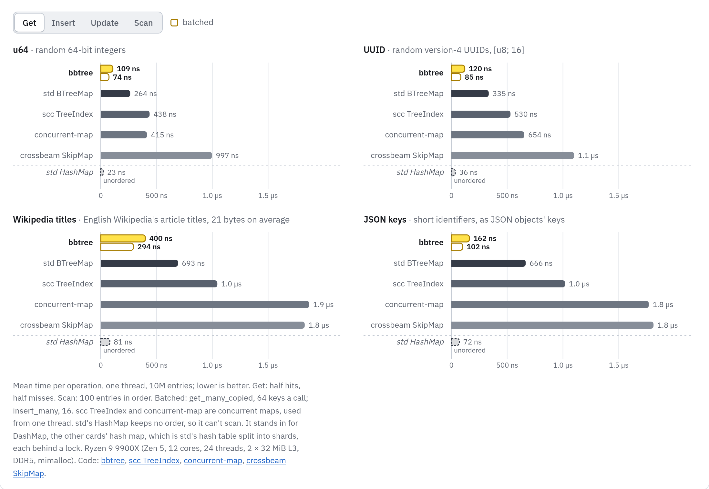
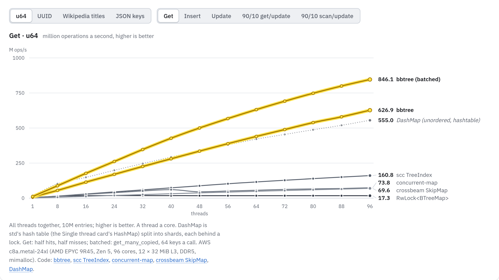
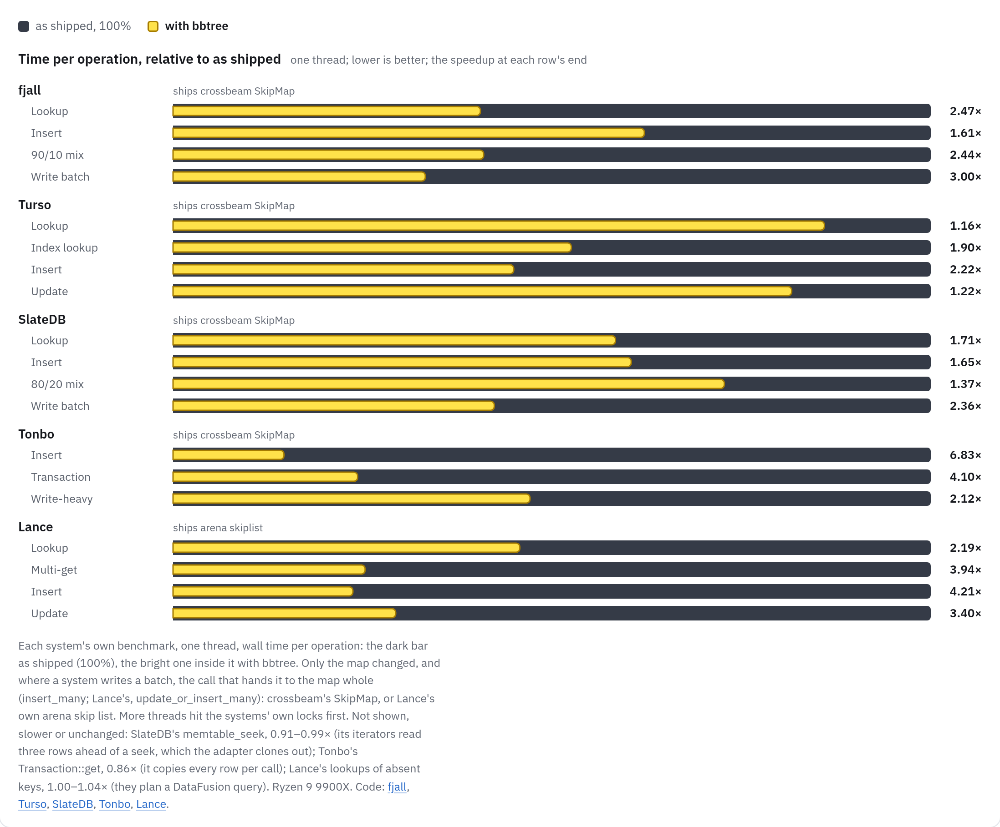
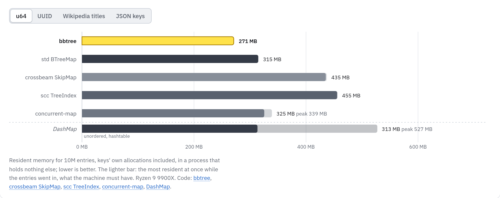
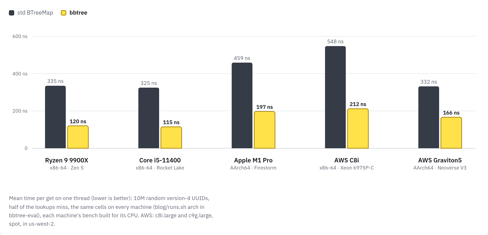

> B-trees are by far the most important access path structure in database and file systems. — [Jim Gray](https://en.wikipedia.org/wiki/Jim_Gray_(computer_scientist)) and Andreas Reuter[^gray]

**bbtree** is by far the fastest B-tree (that I'm aware of):

1. 5× faster than std's `BTreeMap` on a single thread, 12× faster than `crossbeam-skiplist` at 96 threads.
2. 30% lower memory usage.
3. Zero dependencies, `no_std` compatible.
4. `bbtree::unsync::BBTreeMap` is a drop-in replacement for std's `BTreeMap`/`BTreeSet`.
5. Production-ready by formal verification, model checking, deterministic simulation, fuzzing, and lots of testing.
6. Brought to you by decades of database research and careful curation by [Xiangpeng Hao](https://xiangpeng.systems).

::: {.panel-tabset .column-page-right}

## Single thread

{fig-alt="Mean time per get, one thread, 10M entries, on u64, UUID, Wikipedia title and JSON keys: bbtree against std's BTreeMap, scc TreeIndex, concurrent-map, crossbeam SkipMap and std's HashMap."}

## Concurrent

{fig-alt="Gets of u64 keys per second from 1 to 96 threads: bbtree and its batched lookups against DashMap, scc TreeIndex, concurrent-map, crossbeam SkipMap and RwLock<BTreeMap>."}

## End to End

{fig-alt="Time per operation with bbtree, relative to as shipped, in fjall, Turso, SlateDB, Tonbo and Lance."}

## Memory

{fig-alt="Resident memory for 10M u64 entries: bbtree, std's BTreeMap, crossbeam SkipMap, scc TreeIndex, concurrent-map and DashMap."}

## Architectures

{fig-alt="Mean time per UUID get, std's BTreeMap against bbtree, on Ryzen 9 9900X, Core i5-11400, Apple M1 Pro, AWS C8i and AWS Graviton5."}

:::

These are snapshots; the [interactive version](https://bbtree.xiangpeng.systems/post/) switches between keys and workloads. The code is at [XiangpengHao/bbtree](https://github.com/XiangpengHao/bbtree).

## What can it do?

B-trees are the most important data structure in big data systems, a fast b-tree like `bbtree` benefits everything on top of it: agents memory, LLM training, RAG, KV store, state caching, vector search, and more.

Here we discuss three representative use cases:

1. **Replace skiplist in LSM-trees.** In place of the skiplist of four LSM-trees, `bbtree` is 1.37–6.83× faster.
2. **In-memory database index.** In place of Turso's skiplists, inserts are 2.22× and indexed `SELECT`s 1.90× faster.
3. **Mmap a bbtree from disk.** No rebuild after a restart: the first answer comes 160–2,500× sooner than std's `BTreeMap`.

### Case 1: faster memtable

All LSM-trees use an ordered map to hold recent writes in memory, the memtable. In Rust, this ordered map is usually a skiplist, like `crossbeam-skiplist`.

`bbtree` can easily replace it and is much faster. A skiplist takes a cache miss for almost every node it visits on its way down; a `bbtree` lookup touches a handful of cache lines (see [How it works](#how-it-works), below).

`bbtree` has a similar interface as `crossbeam-skiplist` but simpler: there is no epoch, no need to worry about when to pin or re-enter an epoch.

`bbtree` allows more advanced memory management:

1. Custom allocator is supported on day one.
2. It never allocates on irregular sizes (i.e., not a power of two): memory management stays easy, with no external fragmentation[^free-space].
3. Allocation failure can be gracefully handled.

We integrated `bbtree` into four LSM-trees, on each system's own benchmarks:

1. [fjall](https://github.com/fjall-rs/fjall): gets 2.47×, inserts 1.61×, write batches 3.00×.
2. [SlateDB](https://github.com/slatedb/slatedb): gets 1.71×, puts 1.65×, write batches of 10 rows 2.36×.
3. [Tonbo](https://github.com/tonbo-io/tonbo): 10M-row writes 6.83×, conflict-checked transactions 4.10×.
4. [Lance](https://github.com/lance-format/lance)'s MemWAL index (its own skiplist): point lookups 2.19×, batched lookups 3.94×, batched puts 4.21×.


### Case 2: database index

A database's tables change while they are read: rows are inserted, updated and deleted between queries, and every index of a table changes with it. An in-memory database keeps each in an ordered map, which has to stay sorted under these writes.

[Turso](https://github.com/tursodatabase/turso), SQLite rewritten in Rust, keeps its MVCC store in memory: its tables' rows and its indexes' entries, each in a `crossbeam-skiplist`. With `bbtree` in their place, on Turso's own benchmarks:

1. `INSERT` of random rowids: 2.22×.
2. Indexed point `SELECT`: 1.90×.
3. `UPDATE` in `BEGIN CONCURRENT`: 1.22×.
4. Point `SELECT` by rowid: 1.16×.


### Case 3: bbtree-mmap

[`bbtree-mmap`](https://crates.io/crates/bbtree-mmap) allows you to build a bbtree and write it to disk once; when you need it, you can simply mmap it and use it instantly, without rebuilding anything.

```bash
cargo add bbtree-mmap
```

**Build a bbtree and save to disk**

```rust
use bbtree::unsync::BBTreeMap;
use bbtree_mmap::BBTreeMapFile;

let names = BBTreeMap::from([(7_u64, String::from("ferris")), (42, String::from("corro"))]);
BBTreeMapFile::<u64, String>::create("names.bbtree", &names)?;
```

**Mmap bbtree and query it immediately**

```rust
use bbtree_mmap::BBTreeMapFile;

let names = unsafe { BBTreeMapFile::<u64, String>::mmap("names.bbtree").open()? };
assert_eq!(names.get(&42), Some("corro"));
```


## How it works?

Every performance optimization should be guided by a cost model.

B-tree optimizations are simple, three easy pieces[^ostp]: we just need to remember three principles, in order:

1. The number of **chained cache lines** touched. A cache miss costs about 100 ns.
2. The number of **instructions** executed. An instruction costs about 0.5 ns.
3. The amount of **cache coherence traffic**, especially important for concurrent access. It forces a cache miss, and costs a little more than 100 ns.

### 1. Minimize cache misses

With this cost model, it's clear that the most important optimization is to minimize the number of cache misses.
To put it another way, for each cache miss, we want to narrow down the search space as much as we can.

#### Thought experiment: binary search vs linear search

Say we have a sorted array of `u64`s, and we want to find a target `u64`.

With binary search, each cache miss narrows down the search space by half.

With linear search, each cache miss narrows down the search space by `cache_line_size / item_size` items, which is 64 / 8 = 8.

So the break-even point is about 16 items, where binary search costs the same as linear search: two cache misses to find the target.

But there's a catch: 1. the CPU prefetcher may fetch the next cache lines on its own, which gives linear search an even bigger advantage; 2. linear search is simpler, allowing much more parallelism in the CPU pipeline. So the actual break-even point is usually higher.


#### How does that apply to B-trees?

In a B-tree, this decides the node size[^cache-conscious]. If we size nodes so that each holds about 16–32 items, we can always do linear search, which lets us do nice things like SIMD (in later sections).

**What if the keys are Strings?**
`String`s are different, because their bytes are stored on the heap, not inline in the node.
This changes our equation completely. We no longer get 8 keys from one cache miss; instead, each key we load is its own cache miss. So we almost always want to do binary search over `String`s.


**How does `bbtree` do it?**
Heap keys are very common, so `bbtree` must handle them well.
`bbtree` introduces `inline_keys`, an idea databases have used for decades[^graefe-larson][^graefe], similar to German strings[^umbra] and `StringView` in Arrow[^stringview].

With fixed-size inline keys, we get back the benefit of one cache miss loading 8 (or more) keys.
And we only load the full key when the comparison ties.


**What about keys with long prefixes?**
Many keys, like URLs and paths, have long prefixes. If we just take the first 8 bytes as the inline key, we may compare nothing at all.
`bbtree` addresses this with `prefix_keys`: the common prefix of all keys in a node[^prefix-btree].
The beauty of `prefix_keys` is that no node has to store them. Every key in a node sorts between the two separators on either side of the node in its parent. So if those two separators share their first 20 bytes, every key in the node starts with the same 20 bytes.


So each node only stores the length of its prefix, and keeps the window of each key right after it, which makes inline keys far more effective.

**How does this apply to other key types, and how does it work with Rust's type system?**

It's clear that `String` and `Vec<u8>` benefit from this optimization. But integers like `u64` and `u128` can too; we just need to mind the endianness: stored big-endian, their bytes sort in the same order as the numbers.


For other key types, like compound keys in structs, users can implement the `InlineKey` trait, and when they do, we use the inline keys wherever we can.

```rust
pub trait InlineKey: Ord {
    /// How many bytes of each inline key the nodes keep: 2, 4 or 8.
    const WIDTH: InlineWidth = InlineWidth::Eight;

    /// Bytes `offset..offset + 8` of the key's encoding, big-endian,
    /// zero past its end, which orders as the keys do.
    fn inline_key_at(&self, offset: usize) -> InlineWord;
}

// A compound key, ordered by customer, then order: its encoding is
// both fields' bytes, one after the other.
#[derive(PartialEq, Eq, PartialOrd, Ord)]
struct OrderKey {
    customer: u32,
    order: u32,
}

impl InlineKey for OrderKey {
    fn inline_key_at(&self, offset: usize) -> InlineWord {
        let mut bytes = [0; 16];
        bytes[..4].copy_from_slice(&self.customer.to_be_bytes());
        bytes[4..8].copy_from_slice(&self.order.to_be_bytes());
        let start = offset.min(8);
        u64::from_be_bytes(bytes[start..start + 8].try_into().unwrap())
    }
}

let orders: BBTreeMap<OrderKey, u64, _> =
    BBTreeMap::with_strategy(WithInlineKey);
```

The trickiest part is Rust's type system. If we required every key type to implement `InlineKey`, `bbtree` couldn't be a drop-in replacement for std's `BTreeMap`/`BTreeSet`.
Nightly Rust has `specialization`[^specialization] for exactly this.
For stable Rust, we specialize the common types by hand: `u64`, `i64`, `u128`, `i128`, `String`, `str`, `&str`, `Vec<u8>`, `&[u8]`, `Box<str>`, `Box<[u8]>`, `[u8; 16]`, `[u8; 20]` and `[u8; 32]`.
So without any extra work, the built-in types are optimized, and users can still implement the trait for their own types to get the full benefit.

#### Results

After these optimizations, we can show how many cache lines a lookup touches.


#### Bonus: batch mode using Rust's async state machines

So far we have focused on maximizing the value of a cache miss: packing as much information as possible into one cache line.

There's a more advanced optimization: hiding the cost of cache misses.

The simplest way to hide latency is software prefetching: while working on one key, we prefetch the next one.
This usually works well, but it isn't enough for B-trees.

This is because a **B-tree's memory accesses are fundamentally chained**: you don't know which node to fetch next until you have searched the current one.

But B-trees are often read or built in batches, which lets us play a trick with Rust's async state machines. A batch is one call with many keys, such as `BBTreeMap`'s [`get_many_copied`](https://docs.rs/bbtree/latest/bbtree/struct.BBTreeMap.html#method.get_many_copied) and [`insert_many`](https://docs.rs/bbtree/latest/bbtree/struct.BBTreeMap.html#method.insert_many): an array of keys in, an array of answers out.

The high-level idea is simple: in Rust we often treat an IO operation as a `Future`, and `await` it. In `bbtree`, we treat a cache miss as a `Future`, and `await` it too. Database research has interleaved lookups like this for years, by hand and with coroutines[^interleaving].

The code looks roughly like this (they run in a single thread):

```rust
fn get_many<const N: usize>(&self, keys: [&K; N]) -> [Option<V>; N] {
    let lanes = keys.map(|key| self.search(key));
    block_on(join_all(lanes))
}
```

And `search` looks like this:

```rust
async fn search(&self, key: &K) -> Option<V> {
    let mut node = self.root();
    while node.is_internal() {
        let edge = node.search(key);
        node = node.child(edge);
        prefetch(node.header()).await;
    }
    node.get(key)
}
```


But we need to be very careful:

1. A cache miss costs 100 ns, so our `Future` must be as lightweight as possible. This means we can't use `tokio` or any general-purpose async runtime, because their overhead is already higher than a cache miss. `bbtree` polls its lanes with a tiny executor of its own: no allocation, no runtime.
2. Each async function in Rust is a state machine generated at compile time. We want this state machine to be as small as possible, so that switching between states is cheap.
3. There's no way to know whether a cache line is already in cache, so we have to guess. In `bbtree` that's not so hard: once the leaves outgrow the L2 cache, a leaf is almost always a cache miss; smaller trees look their keys up one at a time.

### 2. Minimize instructions

In general, minimizing instructions means reducing CPU time,
which means two things: 1. reducing the instruction count; 2. reducing branches.

A mispredicted branch costs about 20 cycles (the time of 20 instructions), about 10% of a cache miss.

#### Binary search vs linear search, again

With inline keys, searching a node means searching a small array of small integers: 2 bytes a key for integers and UUIDs, 4 to 8 for strings.
Now let's compare their instructions and branches over a node of 32 keys:

1. Binary search: about 5 steps, each a compare and a branch, and the CPU typically guesses wrong half of the time. A branchless binary search[^layouts] avoids the guess, but then each step waits for the one before.
2. Linear search, without its early exit, becomes a count: compare the target with every key, and count the keys smaller than it; that number is the child to follow. It does more compares, but none branches or waits for another, a perfect fit for the CPU pipeline.


#### How does `bbtree` search?

With SIMD, searching a node takes a handful of instructions[^kary].
One AVX-512 instruction compares the target with 32 two-byte keys at once; its result is a 32-bit mask, a bit a key, and the number of ones in the mask, its popcount, is the answer:

```rust
fn child_index(inline_keys: &[u16; 32], target: u16) -> usize {
    let keys = _mm512_loadu_epi16(inline_keys.as_ptr().cast());
    let smaller =
        _mm512_cmplt_epu16_mask(keys, _mm512_set1_epi16(target as i16));
    smaller.count_ones() as usize
}
```

The function has only three steps, all branchless and super fast:

1. `_mm512_loadu_epi16` loads the inline keys into a SIMD register.
2. `_mm512_cmplt_epu16_mask` compares them with the target and returns a mask, a bit for each smaller key, in key order (e.g., `1111100000000000`).
3. `smaller.count_ones()` counts the ones in the mask, which is the index of the child to follow. x86 does this in one instruction, `popcnt`.

We also implement the same search for ARM in NEON, so Apple Silicon and AWS Graviton work too.
On x86, AVX-512 needs `-C target-cpu=native` (Rust 1.89 or later).

#### The compiler is not your friend

We often hear "write simple code and let the compiler optimize it". The extreme version is FastLanes[^fastlanes], whose scalar code the compiler automatically vectorizes (generates SIMD code for).

Here the compiler is not your friend. A node holds few keys, a few dozen at most, and their number is usually not a power of two.
The compiler often considers it not worth vectorizing, and sometimes can't prove it safe, so we write the SIMD by hand, and handle the boundary cases very carefully.
On an M1 Pro, the compiler's own count widened each compare's result to 64 bits and added them up one at a time. We wrote the count in NEON by hand and changed nothing else: the same tree, the same nodes, the same cache lines.
A lookup of a `u64` key in a map of 10M entries went from 1,678 to 407 instructions, and from 390 to 174 ns.[^neon-count]

Vectorization isn't the only problem: sometimes the compiler generates bad code because it doesn't know the workload.
For example, to compare two `&[u8]`, Rust calls `memcmp`, a function call that isn't inlined.
But in `bbtree`, we know the keys are usually short, so instead of calling `memcmp`, we load the bytes as integers and compare the integers. Arrow does the same for `StringView`[^stringview][^arrow-compare].

#### Results


### 3. Minimize cache coherence traffic

Cache coherence traffic happens when one core writes to a cache line that other cores hold. To make sure every core sees a consistent view of memory, CPU caches implement a cache coherence protocol[^primer]. At a very high level, a write to a cache line invalidates all copies of that line in other cores.

This causes two problems: 1. more cache misses; 2. more importantly, it puts a ceiling on the B-tree's concurrency.

On modern hardware, a contended cache line supports at most about 10 M op/s. So if we simply put a `Mutex` over the B-tree, we reach at most 10 M op/s, while `bbtree` reaches 180 M op/s at 96 threads.

Note that a `RwLock` won't help: even a read lock must __increment__ the lock's reader count, which is a write to its cache line.

So how does `bbtree` solve this?

The key idea is a version lock[^olfit][^olc]. Every node carries a version: a reader reads the version, reads the node, and reads the version again. If the version hasn't changed, what it read is consistent; otherwise, it retries.


This allows very high concurrency, because a read causes no write traffic at all.

But there are two things we need to be careful about.

##### Problem 1: we can no longer hand out a `&V` to the user

The value may change, or even be freed, while the user holds the reference, so it's unsafe to use.

We can't return a clone of `V` either, because `V` may not be `Clone`.

Here we use a trick similar to Bf-Tree's[^bftree]: only inner nodes are optimistic; leaves are not.
This works because (1) contention usually happens at inner nodes, (2) values are stored only in leaves, and (3) leaves are only 20% of the nodes on a lookup's path (assuming a tree of 5 levels).
For `Copy` values, `get_copied` goes one step further: it reads the leaf optimistically too, copies the value out, and checks the version after, like a seqlock.

##### Problem 2: memory reclamation

The second problem is more subtle: if one thread is reading a node while another thread frees it, the reader may segfault.

The usual solution is epoch-based memory reclamation[^ebr], e.g., `crossbeam-epoch`.

But then we either leak the epoch to the user, which is ugly and error-prone, or pin an epoch on every access (many libraries do this), which is expensive: every access is a global read and a private write.

In `bbtree`, we do it differently: a freed node never goes back to the allocator while the map lives. Instead, the map keeps it on a free list and reuses it for the next node it needs.
The node keeps its version through both steps: freeing it bumps the version, reusing it bumps the version again, and a version only grows. So a late reader still reads a node, not arbitrary memory, finds a higher version than it saw, and retries, without any segfault.

#### Results


`bbtree` is wildly concurrent: its get throughput grows 83–90× as the core count grows to 96, 86–94% of linear scaling.
At this thread count, `bbtree` is even faster than [DashMap](https://github.com/xacrimon/dashmap), a _hashtable_.

## How do we make it correct?

Performance optimization is easy: you simply ask Claude or Codex to make the code 10× faster on a workload. Speed is measurable, and LLMs can iterate on it relentlessly.

But making sure the code is correct is hard. Correctness is implicit: you can never list every DON'T in the prompt, you can never write enough tests to prove the code correct, and you can never enumerate every property you want to hold.

`bbtree` has three guards to approach correctness.

### Guard 1: Xiangpeng Hao

[Xiangpeng](https://xiangpeng.systems) is a real human behind `bbtree`, and the front line guarding the correctness of its code.
All of the code is written by LLMs, but Xiangpeng steers every design decision, and is accountable for the code.

He spent his PhD writing many, many B-trees, including one that runs in production at Microsoft (Bf-Tree[^bftree]). Choosing `bbtree` means offloading the attention to Xiangpeng.

### Guard 2: LLMs

No human can write better code than LLMs. All of the implementation is written by LLMs, and cross-checked by LLMs from different providers.

### Guard 3: fuzzing, verification, DSTs

Conventional approaches still apply here:

1. **Fuzzing** runs random operations on `bbtree` and std's `BTreeMap` side by side, checks that every answer matches, and checks the whole tree's invariants after every operation: [8 targets](https://github.com/XiangpengHao/bbtree/tree/main/bbtree/fuzz/fuzz_targets), fuzzed weekly and before every release ([CI](https://github.com/XiangpengHao/bbtree/blob/main/.github/workflows/fuzz.yml)).
2. **Verification** with Verus[^verus] proves the critical properties of the code, e.g., that the inline keys order the same way as the keys themselves: [the proofs](https://github.com/XiangpengHao/bbtree/tree/main/bbtree/src/proof), checked on every pull request ([CI](https://github.com/XiangpengHao/bbtree/blob/main/.github/workflows/verus.yml)).
3. **DSTs** (deterministic simulation testing) with Shuttle[^shuttle] and ffs[^ffs] test concurrent behavior in a deterministic and principled way: Shuttle runs [each test](https://github.com/XiangpengHao/bbtree/blob/main/bbtree/src/map/shuttle_tests.rs) under thousands of thread schedules on every pull request ([CI](https://github.com/XiangpengHao/bbtree/blob/main/.github/workflows/shuttle.yml)); ffs, run by its author, found a race Shuttle had missed ([issue #9](https://github.com/XiangpengHao/bbtree/issues/9)), now fixed and tested.

## Reviewers of this post

Thanks to [Andrew Lamb](https://andrew.nerdnetworks.org/) (InfluxData), [Zac Farrell](https://github.com/zfarrell) (Hotdata), [Eddie Tejeda](https://eddietejeda.com/) (Hotdata), [Divya Ranganathan](https://www.linkedin.com/in/divs1101/) (Hotdata), [Jacopo Tagliabue](https://jacopotagliabue.it/) (bauplan), [Wanxiang Zhong](https://shawnzhong.com) and [Junxuan Liao](https://github.com/MikeWalrus) for reviewing this post.

[^ostp]: Not more complicated than an operating system! Remzi H. Arpaci-Dusseau and Andrea C. Arpaci-Dusseau, [Operating Systems: Three Easy Pieces](https://pages.cs.wisc.edu/~remzi/OSTEP/) (2016).

[^free-space]: Remzi H. Arpaci-Dusseau and Andrea C. Arpaci-Dusseau, [Free-Space Management](https://pages.cs.wisc.edu/~remzi/OSTEP/vm-freespace.pdf), chapter 17 of *Operating Systems: Three Easy Pieces*: external fragmentation is free space chopped into pieces of different sizes, so that a request can fail although the total would fit it.

[^gray]: Jim Gray and Andreas Reuter, *Transaction Processing: Concepts and Techniques* (1993), as quoted by Goetz Graefe in [Modern B-Tree Techniques](https://doi.org/10.1561/1900000028) (2011).

[^cache-conscious]: Jun Rao and Kenneth A. Ross, [Making B+-Trees Cache Conscious in Main Memory](https://doi.org/10.1145/342009.335449) (SIGMOD 2000).

[^graefe-larson]: Goetz Graefe and Per-Åke Larson, [B-Tree Indexes and CPU Caches](https://doi.org/10.1109/ICDE.2001.914847) (ICDE 2001).

[^graefe]: Goetz Graefe, [More Modern B-Tree Techniques](https://doi.org/10.1561/1900000070) (2024): keep full keys out of the comparison stream with dense, fixed-width codes, and skip the prefix a page shares.

[^umbra]: Thomas Neumann and Michael Freitag, [Umbra: A Disk-Based System with In-Memory Performance](https://db.in.tum.de/~freitag/papers/p29-neumann-cidr20.pdf) (CIDR 2020); see also my post on [the nature of strings](https://blog.xiangpeng.systems/posts/nature-of-string/).

[^stringview]: Xiangpeng Hao and Andrew Lamb, Using StringView / German Style Strings to Make Queries Faster: [Part 1, Reading Parquet](https://datafusion.apache.org/blog/2024/09/13/string-view-german-style-strings-part-1/) and [Part 2, String Operations](https://datafusion.apache.org/blog/2024/09/13/string-view-german-style-strings-part-2/) (2024).

[^prefix-btree]: Rudolf Bayer and Karl Unterauer, [Prefix B-Trees](https://doi.org/10.1145/320521.320530) (TODS 1977).

[^specialization]: [RFC 1210: impl specialization](https://rust-lang.github.io/rfcs/1210-impl-specialization.html), unstable since 2016 ([tracking issue](https://github.com/rust-lang/rust/issues/31844)).

[^interleaving]: Onur Kocberber, Babak Falsafi and Boris Grot, [Asynchronous Memory Access Chaining](https://www.vldb.org/pvldb/vol9/p252-kocberber.pdf) (VLDB 2015); Georgios Psaropoulos et al., [Interleaving with Coroutines: A Practical Approach for Robust Index Joins](https://www.vldb.org/pvldb/vol11/p230-psaropoulos.pdf) (VLDB 2017); Christopher Jonathan et al., [Exploiting Coroutines to Attack the "Killer Nanoseconds"](https://www.vldb.org/pvldb/vol11/p1702-jonathan.pdf) (VLDB 2018).

[^layouts]: Paul-Virak Khuong and Pat Morin, [Array Layouts for Comparison-Based Searching](https://arxiv.org/abs/1509.05053) (2017).

[^kary]: Benjamin Schlegel, Rainer Gemulla and Wolfgang Lehner, [k-ary Search on Modern Processors](https://doi.org/10.1145/1565694.1565705) (DaMoN 2009).

[^fastlanes]: Azim Afroozeh and Peter Boncz, [The FastLanes Compression Layout: Decoding >100 Billion Integers per Second with Scalar Code](https://www.vldb.org/pvldb/vol16/p2132-afroozeh.pdf) (VLDB 2023).

[^neon-count]: Lookups of `u64` keys that hit, in a map of 10M `u64` entries, one run each on an M1 Pro, with bbtree-eval's [portable probe](https://github.com/XiangpengHao/bbtree-eval/tree/main/diagnostics/portable), before and after [decision D56](https://github.com/XiangpengHao/bbtree/blob/main/design/03-decisions.md), which counts inline keys in NEON.

[^arrow-compare]: arrow-rs [#7748](https://github.com/apache/arrow-rs/pull/7748) compares inlined string views as one `u128`, and their 4-byte prefixes as one `u32`, instead of byte by byte.

[^primer]: Vijay Nagarajan, Daniel J. Sorin, Mark D. Hill and David A. Wood, [A Primer on Memory Consistency and Cache Coherence](https://doi.org/10.1007/978-3-031-01764-3), second edition (2020).

[^olfit]: Sang K. Cha, Sangyong Hwang, Kihong Kim and Keunjoo Kwon, [Cache-Conscious Concurrency Control of Main-Memory Indexes on Shared-Memory Multiprocessor Systems](https://www.vldb.org/conf/2001/P181.pdf) (VLDB 2001).

[^olc]: Viktor Leis et al., [The ART of Practical Synchronization](https://db.in.tum.de/~leis/papers/artsync.pdf) (DaMoN 2016).

[^bftree]: Xiangpeng Hao and Badrish Chandramouli, [Bf-Tree: A Modern Read-Write-Optimized Concurrent Larger-Than-Memory Range Index](https://www.vldb.org/pvldb/vol17/p3442-hao.pdf) (VLDB 2024); code at [microsoft/bf-tree](https://github.com/microsoft/bf-tree).

[^ebr]: Keir Fraser, [Practical Lock-Freedom](https://www.cl.cam.ac.uk/techreports/UCAM-CL-TR-579.pdf) (PhD thesis, 2004); in Rust, [`crossbeam-epoch`](https://docs.rs/crossbeam-epoch).

[^verus]: Andrea Lattuada et al., [Verus: Verifying Rust Programs using Linear Ghost Types](https://doi.org/10.1145/3586037) (OOPSLA 2023); code at [verus-lang/verus](https://github.com/verus-lang/verus).

[^shuttle]: [Shuttle](https://github.com/awslabs/shuttle), a library for testing concurrent Rust code, from AWS.

[^ffs]: [ffs](https://github.com/aoli-al/ffs), fork-based deterministic concurrency testing.
